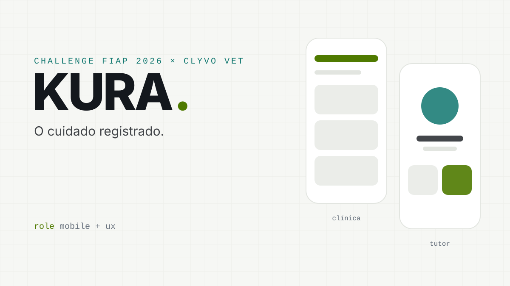

<!-- sola.prd · v4.0 · revisado em 2026-10 · feito à mão, sem template -->

<picture>
  <source media="(prefers-color-scheme: dark)" srcset="assets/header-dark.svg">
  
</picture>

<p align="left">
  <a href="https://www.linkedin.com/in/guilherme-sola-garcia-8b8208351/"></a>
  <a href="mailto:guilhermesolagarcia31@gmail.com"></a>
  
</p>

<br>

<picture>
  <source media="(prefers-color-scheme: dark)" srcset="assets/01-problem-dark.svg">
  
</picture>

Interfaces bonitas que ninguém consegue usar. Interfaces usáveis que ninguém lembra.
Eu trabalho no meio do caminho: **dev que entende UX**, não designer que programa.

<br>

<picture>
  <source media="(prefers-color-scheme: dark)" srcset="assets/02-principles-dark.svg">
  
</picture>

<table>
  <tr>
    <td width="50%" valign="top"><code>[1]</code> <b>Todo movimento precisa de um motivo.</b><br><sub>Se a animação não conta a história, não guia o olho nem responde a uma ação, ela não entra.</sub></td>
    <td width="50%" valign="top"><code>[2]</code> <b>Decidir no navegador, antes do código.</b><br><sub>Opções lado a lado em páginas de comparação. A escolha fica registrada com o motivo.</sub></td>
  </tr>
  <tr>
    <td width="50%" valign="top"><code>[3]</code> <b>O caminho sem animação vem primeiro.</b><br><sub><code>prefers-reduced-motion</code>, fallback sem WebGL, navegação por teclado e HTML de verdade.</sub></td>
    <td width="50%" valign="top"><code>[4]</code> <b>Lógica pura e testada, mesmo no visual.</b><br><sub>Scroll, poses 3D e coordenadas viram funções puras com <code>node --test</code>.</sub></td>
  </tr>
</table>

<br>

<picture>
  <source media="(prefers-color-scheme: dark)" srcset="assets/03-shipped-dark.svg">
  
</picture>

<table>
  <tr>
    <td width="50%" valign="top">
      <a href="https://github.com/guilhermesolagarcia/Projeto-UX-Zod"></a>
      <h3><a href="https://github.com/guilhermesolagarcia/Projeto-UX-Zod">ZOD</a> <sub>· energia que tem cor</sub></h3>
      Landing de energético onde o produto é um objeto 3D, não uma foto.
      <br><br>
      <sub><b>DECISÃO</b> · A lata é 100% procedural. A troca de rótulo é um shader controlado pelo mesmo valor que move o fundo, então os dois nunca dessincronizam.</sub>
      <br><br>
      <code>Three.js</code> <code>GSAP</code> <code>Vite</code> <code>node --test</code>
    </td>
    <td width="50%" valign="top">
      <a href="https://github.com/guilhermesolagarcia/Dragos-Tattoo"></a>
      <h3><a href="https://github.com/guilhermesolagarcia/Dragos-Tattoo">Drago's Tattoo</a> <sub>· a parede de flash no escuro</sub></h3>
      No Brasil, tatuagem se marca pelo WhatsApp, não por formulário.
      <br><br>
      <sub><b>DECISÃO</b> · Sem backend. Todo caminho da página termina numa conversa com a mensagem já escrita. O olho do dragão em WebGL segue o mouse.</sub>
      <br><br>
      <code>HTML</code> <code>CSS</code> <code>JS</code> <code>GSAP</code> <code>Three.js</code>
    </td>
  </tr>
  <tr>
    <td width="50%" valign="top">
      <a href="https://github.com/guilhermesolagarcia/Mangobook-Repo"></a>
      <h3><a href="https://github.com/guilhermesolagarcia/Mangobook-Repo">MangoBook Pure</a> <sub>· pense doce</sub></h3>
      Página de lançamento com 15 seções contadas pelo scroll.
      <br><br>
      <sub><b>DECISÃO</b> · Abertura, navbar, transição de cor e ícones foram testados em páginas de comparação antes de qualquer código definitivo.</sub>
      <br><br>
      <code>React 19</code> <code>Vite</code> <code>R3F</code> <code>GSAP</code>
    </td>
    <td width="50%" valign="top">
      <a href="https://github.com/KURA-Clyvo">
        <picture>
          <source media="(prefers-color-scheme: dark)" srcset="assets/kura-dark.svg">
          
        </picture>
      </a>
      <h3><a href="https://github.com/KURA-Clyvo">KURA</a> <sub>· Challenge FIAP 2026 × Clyvo Vet</sub></h3>
      Plataforma veterinária para clínicas e tutores, feita em time.
      <br><br>
      <sub><b>PAPEL</b> · Responsável por Mobile e UX do projeto, dos apps de clínica e tutor à experiência do usuário.</sub>
      <br><br>
      <code>React Native</code> <code>Expo</code> <code>TypeScript</code>
    </td>
  </tr>
</table>

<br>

<picture>
  <source media="(prefers-color-scheme: dark)" srcset="assets/04-scope-dark.svg">
  
</picture>

<p>
  
</p>

```text
interface    React · React Native/Expo · TypeScript · JavaScript (ES Modules) · Tailwind
motion / 3d  GSAP + ScrollTrigger · Three.js · React Three Fiber · Framer Motion
dados        Oracle · PL/SQL
process      PRODUCT.md → DESIGN.md → plano → código
```

<br>

<picture>
  <source media="(prefers-color-scheme: dark)" srcset="assets/05-non-goals-dark.svg">
  
</picture>

```diff
- animação que não conta a história
- template com cara de template
- interface que só funciona com mouse, WebGL e motion ligados
+ interface que alguém lembra e consegue usar
```

<br>

<picture>
  <source media="(prefers-color-scheme: dark)" srcset="assets/06-roadmap-dark.svg">
  
</picture>

- [x] ZOD, Drago's Tattoo e MangoBook Pure
- [ ] KURA na NEXT 2026
- [ ] Concluir ADS na FIAP
- [ ] Publicar os projetos com demo ao vivo

<br>

<picture>
  <source media="(prefers-color-scheme: dark)" srcset="assets/07-see-also-dark.svg">
  
</picture>

Quer conversar sobre interface, motion ou produto? O caminho mais rápido é o [LinkedIn](https://www.linkedin.com/in/guilherme-sola-garcia-8b8208351/) ou o [e-mail](mailto:guilhermesolagarcia31@gmail.com).

<br>

<picture>
  <source media="(prefers-color-scheme: dark)" srcset="assets/footer-dark.svg">
  
</picture>
